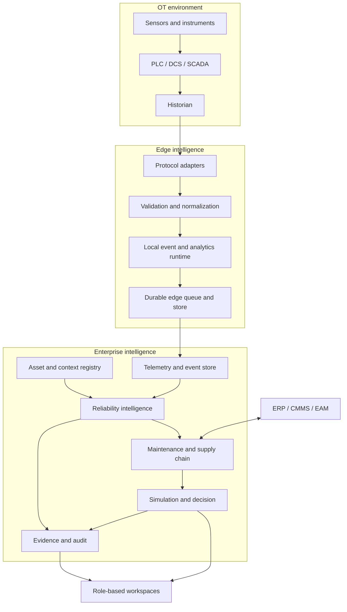

# A03 — System Context and Logical Architecture

**Status:** Initial logical architecture.

## Context
IDIP consumes approved data from industrial OT and enterprise systems, builds contextual assessments and provides decision support to authorized users. External systems include sensors, PLC/DCS/SCADA, historians, gateways, CMMS/EAM, ERP, document systems, identity providers, suppliers and approved external data services.

## Logical layers
1. OT environment: instruments, control/supervisory systems, historians.
2. Edge intelligence: protocol adapters, validation, normalization, local event processing, local persistence and synchronization.
3. Data/context: asset registry, telemetry, events, maintenance history, documents and evidence.
4. Industrial intelligence: condition monitoring, anomaly detection, diagnosis, degradation and reliability analytics.
5. Enterprise operations: maintenance, work management, BOM, inventory, supplier and procurement adapters.
6. Simulation/decision: scenario models, constraints, risk/economic analysis, optimization and approvals.
7. Experience/integration: role workspaces, APIs, reporting and controlled connectors.
8. Cross-cutting governance: identity, authorization, audit, provenance, cybersecurity and model governance.

## Logical flow

## Trust rules
OT data passes through site-approved gateways; edge processing continues during connectivity loss; only approved data crosses trust boundaries; enterprise-to-edge configuration is authenticated/versioned/auditable; no default inbound route to plant control; LLM is not in control path; write-back disabled pending specific approval.

## Deployment profiles
Edge-only, hybrid, customer-private enterprise, or managed cloud where policy/connectivity permit. A telemetry chart alone is not a digital twin: a twin requires asset identity, component relationships, context, state history, sensor mapping and traceable physical linkage.