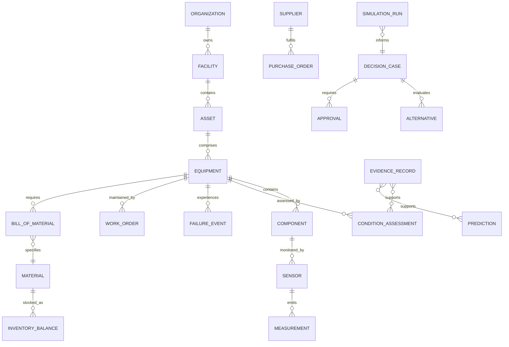

# A05 — Canonical Domain Model

**Status:** Conceptual model; physical schema pending workload/security review.

## Principles
Separate physical identity from telemetry tags; preserve source IDs; store units/timestamps explicitly; distinguish observations from derived assessments/predictions; scope tenant/facility ownership; version taxonomies/envelopes/models; retain provenance and audit links.

## Core entities
Organization, BusinessUnit, Facility; Asset, Equipment, Component, EquipmentClass; Sensor, Tag, Measurement, OperatingMode, OperatingEnvelope; ProductionRun, OperationalEvent, DataQualityAssessment; FailureMode, FailureEvent, ConditionAssessment, Anomaly, Prediction, Model, ModelVersion, ModelValidation; MaintenanceStrategy, WorkOrder, MaintenanceTask; Material, BillOfMaterial, InventoryBalance, Warehouse, Supplier, PurchaseRequisition, PurchaseOrder, GoodsReceipt; Simulation, SimulationRun, Scenario; DecisionCase, Alternative, Constraint, Recommendation, Approval, DecisionOutcome; EvidenceRecord, SourceRecord, AuditEvent, IntegrationEndpoint, SyncBatch.

## Principal relationships

## Measurement minimum fields
Canonical ID; tenant/facility/asset/equipment/component references where known; source system/tag; parameter/value/unit; event and ingestion timestamps; quality status/flags; sampling metadata; gateway identity; schema version; provenance reference.

## Analytical output minimum fields
Output ID/type; asset/equipment; operating context; source references/window; method/model/rule version; generation time; result/unit; uncertainty; validation/domain status; limitations; human review state.

## Persistence candidates
PostgreSQL for transactions/config/workflow; TimescaleDB or dedicated time-series store after workload tests; S3-compatible object store for files/documents/artifacts; vector index only for approved retrieval; edge-local durable DB/queue; event broker when workload warrants. Every tenant-owned record needs explicit scope and server/database authorization. Service-role credentials never reach browser clients.